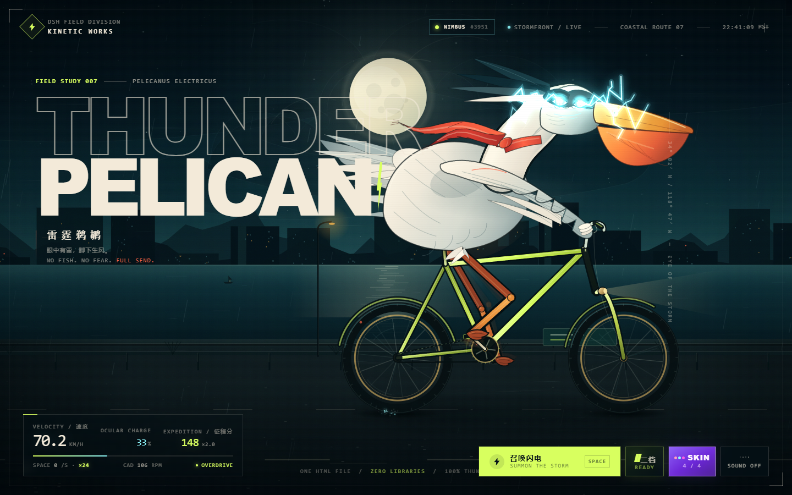
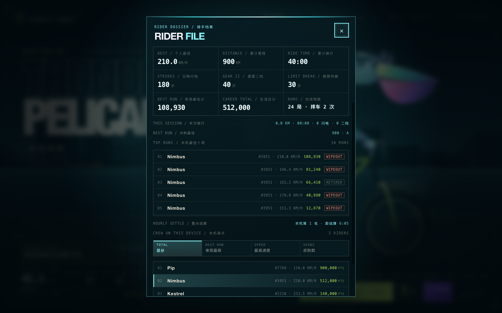
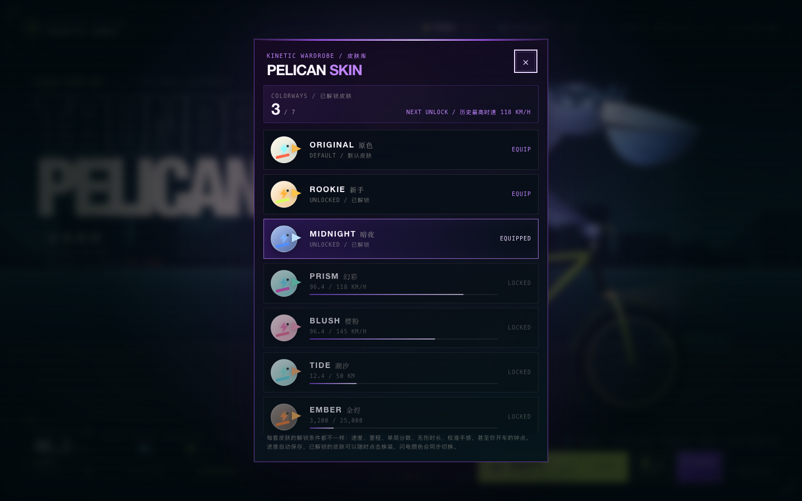
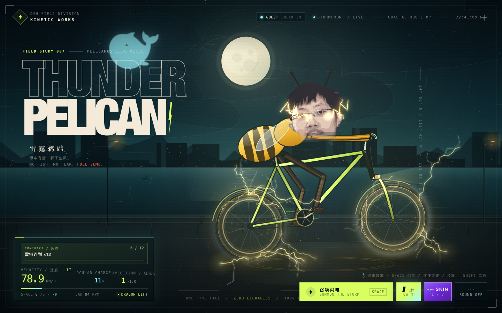
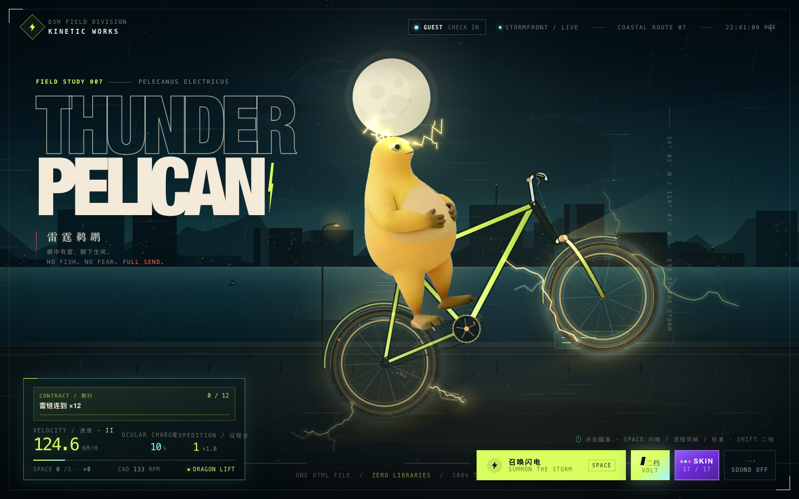
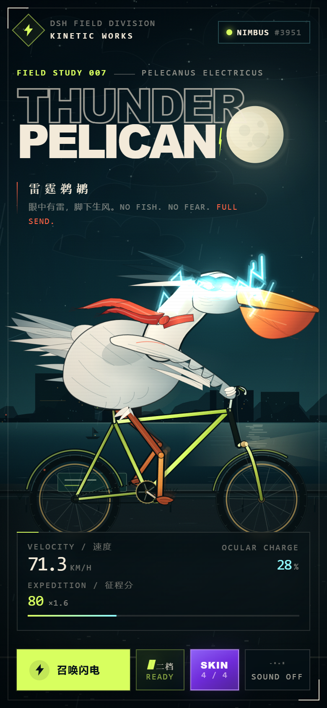

# Thunder Pelican · 雷霆鹈鹕

**[立即试玩《雷霆鹈鹕》](https://imnotorangewong.github.io/Thunder-Pelican/)**

> 一只眼睛冒闪电的鹈鹕，骑着单车穿过风暴海岸。

`Canvas 2D` · `No dependencies` · `No build step` · `GitHub Pages ready`



[本次更新说明](更新说明.md)

## 项目简介

游戏主体在 `index.html`：经典鹈鹕、自行车、海岸、闪电和 UI 都由 Canvas 绘制。另有 12 款原创骑手皮肤、13 种骑手形态，
以透明 WebP 插画按需加载；其中昼夜双龙是一款可切换暗、亮形态的皮肤。每个角色的主题小徽记都应保留在角色身上，保持参考图的形状和比例，清晰可辨但不放大到抢主体，不拉伸、不变形。

几处设计上比较较真的地方：

- 车和鹈鹕是手画的。踏板转一圈，腿跟着动一圈；路面起伏会传到车架上。
- 雷霆二档不是简单提个速：先龙抬头，落地趴下，结束时自己坐直。
- 轮子会甩雷。雷弧随机分叉，活不过零点几秒，接地那下带冲击闪。
- 分数不设上限，靠连击、无伤、超频三条独立乘区拉开差距。
- 雷霆二档开启后三秒内连按空格或连点闪电可以增幅，最高 198 KM/H。
- 排行榜只有一份，在服务器上：顶栏「榜单」按钮打开，`每人一条最佳成绩`，破纪录才覆盖。
- 成绩上传后服务端会按同一套公式复核，改过的分进不了榜；连不上就排队，下次联网补交。
- 本机骑手仍能按总分、单局、速度、皮肤数四种意思排名次——那是「谁在这台机器上」，不是战绩榜。
- 每局发一张契约：速度保持、雷链、无伤……做完给分，再换下一张。
- 天上偶尔飘过一只发光的鲸鱼，点它三下会掉下点东西。
- 十八套皮肤：经典鹈鹕、12 款原创骑手（共 13 种角色形态，昼夜双龙可切换），以及 5 款隐藏事件角色。
- 号牌、称号、进度都只写进这台机器的 localStorage。不用注册，也不上传。
- 打开页面就循环播主题曲，声音分**背景音乐 / 游戏音效 / 皮肤语音**三条通道，各自开关和音量。
- 点「计时挑战」开局，再点「结束挑战」可提前结算峰速与征程。满 30 秒自动结算。
- 一局结束弹结算面板：最终得分、本局最快、历史最快、全球名次、A–E 综合评级。

右上角的「主创说」展示两位主创的 GitHub 头像、署名、学校校徽和共同留言。点击头像可查看 GitHub 主页。

骑行界面常驻显示速度、征程分和底部操作。点「当前契约」可以查看任务和进度。皮肤解锁从右上角提示，骑行继续进行。

## 运行

双击 `index.html` 就能玩。如果浏览器不让打开本地文件，起个静态服务器：

```bash
python3 -m http.server 8000
# 打开 http://localhost:8000/
```

不用 `npm install`，不用构建。运行时请保留 `index.html` 及 `assets/skins/`、`assets/dragon/`、`assets/audio/` 和 `assets/creators/`。

## 操作

| 操作 | 功能 |
| --- | --- |
| `Space` | 召唤闪电 / 加速；雷霆二档开启后三秒内用于测 CPS；压力挑战中连按挣脱巨石 |
| `Shift` | 开启雷霆二档（龙抬头 + 落地俯身 + 轮组放电） |
| 鼠标点击 / 触屏点击 | 在指定位置召唤闪电 |
| `P` | 暂停 / 继续 |
| `R` | 打开骑手档案（含本机排行榜）；未登记时打开登记 |
| 「皮肤」按钮 | 点击或按 Enter 打开皮肤库；**不会使用 Space 打开** |
| 「计时挑战」按钮 | 点击或聚焦后按 Enter 开局，再按一次提前结算。按钮显示倒计时和结算成绩 |
| 「榜单」按钮 | 打开排行榜（前 20 名 + 你自己的名次）；没接服务器时面板会说明原因 |
| `设置` 按钮 | 打开声音与画面设置：三条声音通道、GPU 节能画质开关 |

> Space 用于召唤闪电和二档突破。即使焦点在皮肤库或骑手按钮上，按 Space 也不会打开面板。

## 声音与画面设置

右上角是「设置」，点开后可以分别调整三条声音通道，也可打开 GPU 节能画质：

| 通道 | 管什么 | 默认 |
| --- | --- | --- |
| 背景音乐 `Music` | 《雨爱（司凤版）》，约 2 分 20 秒，整段循环 | 开 · 100% |
| 游戏音效 | 闪电、流光、二档提示，以及随速度和踏频变化的风声与链条声 | 开 · 100% |
| 皮肤音效 `Skin voice` | 各皮肤的语音（比如雷霆猪的「我勒个雷」、黄金时刻的召唤音） | 开 · 100% |

每条通道两个控件：左边 `开 / 关` 直接切通道，下面那条滑轨拖圆点调相对音量（0–100%）。
设置写进 `localStorage` 的 `thunder-pelican.audio.v1`，下次打开还是你调的样子；清掉站点数据回到默认。

- **默认全开、全拉满。** 打开页面就尝试播音乐；浏览器不允许静默自动播放，被拦下时会在你
  **第一次点击或按键**之后补播，游戏本身不用先点任何按钮。
- 音乐走 `<audio>` 元素的 `volume`（留了 0.72 的余量给音效），游戏音效走 Web Audio 主增益，
  皮肤语音走每个播放器实例的 `volume`——三条互不干扰，可以只留音乐把音效关掉。
- 原来那个 `SOUND ON / SOUND OFF` 按钮已经被这个面板取代。切到别的标签页会静音，回来自动恢复。
- 默认使用高清画布，支持 2× Retina。开启 **GPU 节能画质**后会降低 Canvas 分辨率以及星点、雨线、光点和速度线数量，并把动画帧率限制在 40 FPS（触屏设备 30 FPS）；同时隐藏噪点和扫描线覆盖。城市天际线会缓存成离屏图层，暂停、隐藏标签页或弹窗遮住游戏时跳过不必要的 Canvas 重绘。关闭后恢复较高分辨率、更多环境粒子与纹理覆盖，并取消帧率限制；设置会保存在本机浏览器。

## 30 秒挑战：`Speed Trial`

底部「计时挑战」是一局独立计时赛。

- 点「计时挑战」开始，按钮显示「结束挑战」和剩余秒数。骑行中点击场景或按空格仍可加速。
- 再点「结束挑战」或跑满 30 秒会记录本局峰速，同时结算征程。暂停时倒计时冻结。
- 本局成绩取开局到结束之间的最高速度，包含开局速度和二档提速。减速或摔车后，已达到的峰值仍然有效。
- 按钮显示「本局最速」及成绩。可以点它开始下一局，6 秒后按钮自动恢复待机并显示本次会话的最高纪录。
- 登记、切换骑手或结算征程时，也会结清正在进行的挑战。计时成绩取峰速，全球榜按征程分排名。

## 征程计分：`Expedition Score`

打开游戏即可开始征程。结束挑战、在榜单点「结算本局」、翻车、换骑手或离开页面都会结算。触屏设备切到后台时也会保存达标成绩，回来开始新一局。
HUD 左上角实时显示当前分数与总乘区。

### 设计目标

- **分数要能拉开**。不是「骑满 N 秒拿固定分」，而是三条各自独立、得换打法才能一起做大的乘区。
- **不设上限**。骑得越久、超频越深，分越高。没有封顶，也没有刷满一说。
- **能交给服务器复核**。计分逻辑是一个不碰 DOM 的纯函数对象，服务端原样跑一遍就能重算。

### 计分公式

骑行每秒产生的基础分随速度呈二次曲线增长：

```text
base = 3 * (speed / 100) ^ 2.2        // 每秒
gain = base × 连击乘区 × 无伤乘区 × 超频乘区 × dt
```

| 乘区 | 取值 | 怎么变大 |
| --- | --- | --- |
| 连击乘区 | `1 + min(chain, 24) × 0.04`，上限 **×1.96** | 1.35 秒内连续手动召唤闪电累积雷链 |
| 无伤乘区 | 前 5 分钟每 20 秒 +0.1，封顶 **×2.5**；之后每 20 秒 +0.01，没有上限 | 干净骑行攒乘区，出事故归零回 ×1.0 |
| 超频乘区 | 速度超过额定值时 `1 + (速度 - 额定值) / 28` | 在超频区骑得越快，系数越高 |

基础分只跟速度有关，最后一位乘数看上面三条。46 KM/H 巡航，每秒约 **0.55 分**；166 KM/H 时约 **10.7 分**；
250 KM/H 接近 **29 分**。骑同样长的时间，在哪个速度带，基础分就差几十倍。

> **v2 改动**：早先无伤乘区是纯线性累加，总分于是约等于「时长²」，半小时慢骑能顶掉几分钟
> 超频，跟"骑得快才有分"正好相反。现在前五分钟照样给到 ×2.5，之后只慢慢爬。顺带把超频乘区
> 从 `/40` 收紧到 `/28`，闪电基础分从 3 提到 5。

### 一局分数的全部来源

| 来源 | 分值 | 说明 |
| --- | --- | --- |
| 骑行 `rate` | 见公式 | 主体收入，随三条乘区放大 |
| 手动闪电 `strikes` | `5 × (1 + min(chain, 24) × 0.08)` / 次 | 单次最多约 14.6 分，既拿分也续雷链 |
| 突破上限 `breaks` | `40 × (新上限 / 132)` / 次 | 每次抽到更高的二档上限 |
| 超频记录 `hyper` | 50 / 次 | 每超出额定值 10 KM/H 记一次 |
| 雷霆冲刺 `storm` | `冲刺分 × 评级系数` | C 0.5 / B 0.7 / A 0.95 / S 1.25 |
| 挣脱巨石 `pressure` | 300 | 压力挑战成功 |
| 契约完成 `contract` | 150 / 300 / 500（按档位） | 见下面的「征程契约」，一局可以完成好几张 |

### 分数不封顶，速度有硬上限

征程分继续按速度、连击、无伤和超频乘区累积，不设总分上限。当前二档速度上限随 CPS 提升，最高 **198 KM/H**。超过骑手额定速度后，翻车风险随超速增加。

### 面向服务器：纯函数引擎 + 事件日志

`ScoreEngine` 是一个普通对象，**不引用任何 DOM、Canvas、全局 state 或计时器**，
因此整段代码可以原样复制到服务端重放：

```js
ScoreEngine.version          // 计分规则版本号，规则变更时 +1
ScoreEngine.createRun(seed)  // 开一局
ScoreEngine.rateScore(run, dt, speed, rated, chain)
ScoreEngine.contract(run, t, id, bonus)   // 契约完成，返回实发分数
ScoreEngine.end(run, t, reason) -> { score, breakdown, logHash, logTail }
ScoreEngine.fnv32(str)       // FNV-1a 32 位，用于给事件日志生成指纹
```

每一局都会生成一个交付给服务器的复核包：

```text
runId    = run_<时间戳36进制>_<随机种子36进制>
logHash  = fnv32(log.join("|")) 的 8 位十六进制
log      = 完整事件日志（最多 720 条，约 24 分钟）
trace    = 速度轨迹 [本局第几秒, 速度]，每 0.25 秒一个点，最多 2000 点
traceHash= 轨迹的 FNV-1a 指纹
```

事件码：

| 码 | 含义 | 载荷 |
| --- | --- | --- |
| `V` | 采样（每 2 秒） | `速度/连击` |
| `S` | 手动闪电 | 当前连击数 |
| `B` | 突破上限 | 新上限 |
| `H` | 超频记录 | 当前速度 |
| `R` | 雷霆冲刺结算 | `冲刺分/评级系数` |
| `P` | 挣脱巨石 | — |
| `Q` | 契约完成 | `契约 id/得分` |
| `C` | 历史雷击校准事件 | `评级/当前校准链` |
| `A` | 事故 | — |
| `W` | 本局结束 | 结束原因 |

接服务器时，把 `runId` + `seed` + 事件日志 + 速度轨迹上传，服务端做三件事：
离散分七桶按公式原样重算、骑行速率用轨迹围上界、`logHash` 与 `score` 交叉核对。
够得上的才入榜，剩下的按原因退回（`bucket_mismatch` / `rate_implausible` / `score_mismatch`……）。

这一步已经写好了，在 `server/lib/audit.js`；接口、部署和审计的边界见 [DEPLOY-SERVER.md](DEPLOY-SERVER.md)。

## 征程契约

开始骑的时候会发一张契约，点 HUD 上的「当前契约」即可查看。做完给分，隔 2.4 秒换下一张。

契约按当前骑手的额定速度算，不会发一个骑不到的目标：

| 类型 | 一档 / 二档 / 三档 | 判定 |
| --- | --- | --- |
| 速度保持 | 额定值 −20 撑 6 秒 / 额定值撑 8 秒 / 额定值 +12 撑 10 秒 | 速度目标至多 190 KM/H，降速时暂停计时 |
| 雷链 | ×12 / ×16 / ×20 | 取这张契约里的最高链 |
| 无伤 | 60 / 90 / 120 秒 | 中途被反噬就从头攒 |
| 召唤闪电 | 40 / 60 / 80 次 | |
| 二档突破 | 无 / 2 次 / 3 次 | 二档按键频率达标后增加进度 |

- 档位看法：1–2 级一档，3–5 级二档，6 级以上三档。同一局每完成 3 张再抬一档，最多三档。
- 奖励：150 / 300 / 500 分，外加 20 / 35 / 50 XP。契约分在结算卡里单独一栏。
- 同一张契约不会连着发两次。

## 个人最佳幽灵线

每个骑手会存下**分数最高的那一局**的曲线，每 2 秒一个点。下一局骑到第 N 秒时，
分数下面会显示 `PB +180` 或 `PB −40`：和纪录的同一时刻比，你现在是领先还是落后。
第一次反超会弹一条提示。

- 只有分数超过旧纪录的局才会替换曲线；不到 8 秒或不到 60 分的行程不参与。
- 换骑手就是换幽灵。访客的纪录放在 `localStorage` 的 `thunder-pelican.ghost.v1`。
- 曲线最多留 600 个点，大约 20 分钟，再长就丢掉最早的。

## 雷霆二档与速度风险

### 二档前三秒：CPS 增幅

雷霆二档持续 **5 秒**，冷却 **8 秒**。开启后的前三秒记录空格、闪电按钮和场景点按的滚动一秒峰值，按住空格产生的自动连发不计数。三秒结算时，低于 3 CPS 保持基础上限 **132 KM/H**；达到阈值后，峰值越高，上限越高，CPS 按 3–8 区间封顶：

```text
t = (min(峰值 CPS, 8) - 3) / 5
无完美轮盘：cap = round(136 + 62 × (1 - (1 - t)^1.6))
```

因此普通 CPS 增幅约在 **136–198 KM/H**。每次二档启动会进行一次 **5% 幸运判定**；幸运触发时，如果峰值只有 3 或 4 CPS，就按 5 CPS 结算。幸运判定只生效一次，不会在同一次二档内重抽。

轮盘校准暂时退出骑行流程。既有成绩和审计仍能读取旧版校准事件。

### 额定速度和翻车风险

骑手额定速度由雷霆等级决定。它仍是超频风险曲线的起点，而不是氮气速度的硬上限：

| 等级 | 额定值 | 名称 |
| --- | --- | --- |
| Lv 1 | 166 KM/H | TIER I |
| Lv 2 | 186 KM/H | TIER II |
| Lv 5 | 204 KM/H | TIER III |
| Lv 10 | 224 KM/H | TIER IV |

只要二档开启且速度高于额定值 **2 KM/H 以上**，就沿用原有翻车风险：

```text
风险/秒 = min(5.5%, 0.6% + (速度 - 额定值) × 0.22%)
```

| 超出额定值 | 每秒风险 | 10 秒内存活概率 |
| --- | --- | --- |
| +6 KM/H | 1.9% | 约 82% |
| +20 KM/H | 5.0% | 约 60% |
| +30 KM/H 以上 | 5.5%（封顶） | 约 57% |

这是给超频开的价格：乘区给得高，是因为它撑不了多久。

### 两种结束方式

| 类型 | 触发 | 后果 |
| --- | --- | --- |
| 雷霆反噬（软性） | 鹈鹕形态下每次手动闪电 0.38% 概率 | 只把**无伤乘区清零**（长局积累的乘区消失），分数保留，本局继续 |
| 超频翻车（硬性） | 按上面的风险曲线判定 | 本局**立即结束并结算入榜**，弹出结算卡，车架复位重开 |

> 面板开着不掷翻车骰子。档案、皮肤库和冲刺结算打开时都不会摔，免得一打开就中招。

## 结算面板：`Run complete`

一局结束（超频翻车）会弹结算面板，从上到下是：

| 项 | 说明 |
| --- | --- |
| 最终得分 | 本局征程分，含明细拆分（骑行 / 闪电 / 突破 / 超频 / 契约 / 冲刺 / 脱困） |
| 本局最快 | 这一局的峰值时速 |
| 历史最快 | 这位骑手的历史最高时速；本局刷新了记录会点亮成酸性绿 |
| 排行榜 | 全球第几 / 共多少人；先显示 `…核对中`，服务端复核完换成 `#n · 已校验` |
| 综合评级 | `A` – `E`，分数或本局峰值任意一项达标即得，见下表 |

| 评级 | 分数 | 或 峰值时速 |
| --- | --- | --- |
| `A` | ≥ 9000 | ≥ 210 KM/H |
| `B` | ≥ 3500 | ≥ 175 KM/H |
| `C` | ≥ 1200 | ≥ 145 KM/H |
| `D` | ≥ 300 | ≥ 110 KM/H |
| `E` | 其余 | 其余 |

面板底部居中一个 `确认 / CONFIRM`，点它（或按 Esc）关闭面板并重新出发——
摔车后车架复位、速度回到 46.2，新的一局立刻开始。

## 排行榜：一个按钮，一份榜

点顶栏的「榜单」打开面板。**排行榜保存在服务器上**。

```html
<!-- index.html 头部：填了才有榜 -->
<meta name="tp-leaderboard-api" content="/api" />
```

留空就是纯单机：面板会直说「没有接入排行榜」，一个请求都不发，游戏照常玩、能离线。
填成 `/api`（同域）或 `https://api.example.com/api`（跨域）之后，同一个文件就变成联网版。

### 面板里是什么

| 部分 | 说明 |
| --- | --- |
| 标题行 | 总人数，例如 `1,284 位骑手`；右上角是关闭 |
| 榜单 | 前 20 名，一行一个人：名次、名字、号牌 · 峰速 · 时长、分数 |
| 高亮 | 你自己那一行有青色竖线；前三名的序号是酸绿色 |
| 底部 | `你 / YOU #87 / 1284`，掉出前 20 也知道自己第几 |
| 规则提示 | `整点结算 · 前三名解锁「黄金时刻」`，顺带算给你「还差 3 名」 |
| 按钮 | `刷新 / REFRESH`、`关闭 / CLOSE`；Esc 也能关 |

### 覆盖规则：每人一条，破纪录才覆盖

服务端按 owner（一个注册骑手，或者这台浏览器的匿名 id）存**一条**记录：

```text
新分数更高                        → 覆盖
同分，但峰值速度更高               → 覆盖
同分同速，先到的人保住记录         → 不覆盖
都不满足                          → 不覆盖
```

所以一个人跑二十局，榜上也只有一行，那一行会一直往上走。有人问「为什么我的分数没变」，
答案通常是：那一局没超过自己的纪录。服务端回执里的 `replaced` 就是这个判断。

### 入榜时机与过滤

达标的征程结算后会提交全球榜。门槛是至少 8 秒和 60 分。
名次由服务器复核后返回。
服务器明确拒收的（改过分的、缺轨迹的）显示 `未收录`。

### 上传与补交

每局提交分桶、事件日志、速度轨迹和指纹。成绩先进入本机待提交队列，收到服务器确认或明确拒收后才移除。
如果关页时网络中断，下次打开游戏、回到前台、恢复联网或刷新榜单时会补交。

### 服务端

`server/` 是零依赖 Node：`node app.js` 就起，托管页面 + `/api/leaderboard` `/api/runs` `/api/rank`
`/api/health`，自带成绩审计、限流、gzip、ETag、优雅退出。

部署方式有五套（单机 Docker + Caddy / systemd + Nginx / Fly.io 这类 PaaS / 静态前端 + 独立 API /
Cloudflare Workers + D1），环境变量、接口契约、审计边界、容量估算都在
**[DEPLOY-SERVER.md](DEPLOY-SERVER.md)**。

## 本机骑手：四种排名口径

这一段讲的是**这台机器上有哪几位骑手**（也就是骑手切换器），不是战绩榜。四个按钮切换排名方式，同一份存档能排出四种名次：

| 排名 | 看什么 | 谁排前面 |
| --- | --- | --- |
| `TOTAL / 总分` | 生涯累计征程分（`scoreTotal`） | 骑得最久的那位 |
| `BEST RUN / 单局最高` | 单局最佳分（`scoreBest`） | 有一把硬成绩的那位 |
| `SPEED / 最高速度` | 历史最高时速 | 把车推得最快的那位 |
| `SKINS / 皮肤数` | 已解锁皮肤数量（含隐藏彩蛋） | 收集得最全的那位 |

行末的大数字是当前口径，行中的小字是号牌加一项副指标。切换立刻生效，选中的口径记在
`thunder-pelican.crew.v1` 里，下次打开还是这一栏。同分先比生涯总分，再比最高时速。
当前骑手左边有一条青色竖线，点任意一行就能换过去。



## 皮肤与解锁条件

皮肤库按解锁难度排。除经典鹈鹕外，12 款原创皮肤提供 13 种骑手形态，各有独立插画和骑行动作。动画沿用角色原画。双脚交替踩踏，双手贴住车把，肩肘、发梢和头部随发力轻动。骑手会眨眼，加速时还有轻微的呼吸表情。车辐和轮圈亮线跟随车速旋转。巡航时，流光沿角色头发、袖口、衣摆和车轮向后流动。二档起步时后轮甩出扇形光浪并点亮湿路，持续加速留下渐细的主题色尾迹。连按达标突破时，前轮外侧还会扫过一道短促的弧光。五款事件角色保留原有造型和雷霆效果。没解锁的皮肤会显示进度条。

| # | 皮肤 | 解锁条件 | 配套效果 |
| --- | --- | --- | --- |
| — | `ORIGINAL / 原色` | 默认拥有 | 青色 + 酸性绿雷霆 |
| 01 | `DIGITAL STAR / 数字偶像` | 完成 **1** 局征程 | 青紫流光 |
| 02 | `NOIR MAID / 黑曜女仆` | 历史最高时速 **68 KM/H** | 冰蓝流光 |
| 03 | `MINIMAX FILM / 橘光创作` | 累计里程 **8 KM** | 珊瑚粉流光 |
| 04 | `MOON MELODY / 月弦歌姬` | 历史最高时速 **88 KM/H** | 月白紫流光 |
| 05 | `AZURE TRAVELER / 青蓝行者` | 累计里程 **25 KM** | 天青流光 |
| 06 | `CLINIC COMPANION / 蓝心守护` | 单局征程分 **25,000** | 医疗蓝流光 |
| 07 | `DUAL DRAGON / 昼夜双龙` | 点星活动（1 分钟星数增长或验证本人账号） | 暗形态为琥珀金与暮紫，亮形态为银白与冰紫。流光随变身渐变 |
| 08 | `SUNFLOWER SCHOLAR / 向阳学者` | 历史最高时速 **100 KM/H** | 琥珀金流光 |
| 09 | `STAR CAT / 星夜猫灵` | 累计摔车 **5** 次 | 星紫流光 |
| 10 | `CLOUD LAMB / 云绵绵` | 本地时间 **22:00–05:00** 骑行满 30 秒 | 云蓝流光 |
| 11 | `ROYAL RIDER / 赤焰骑士` | 二档突破 **6** 次 | 赤金流光 |
| 12 | `FOX GOTHIC / 赤狐哥特` | 历史最高时速 **145 KM/H** | 暖金流光 |

另有 **5 套隐藏事件皮肤**，解锁前不出现在皮肤库、计数或「下一解锁」提示里：

| 皮肤 | 触发方式 | 配套效果 |
| --- | --- | --- |
| `THUNDER PIG / 雷霆猪` | 被雷霆反噬劈中（0.38% 概率） | 玫粉 |
| `CITY PIGEON / 鸽子` | 压力巨石挑战成功 | 天蓝 |
| `FLAT PIG / 死猪` | 压力巨石挑战失败 | 灰粉 |
| `LIANG WENBEE / 梁文蜂` | 天上出现鲸鱼时连点它 **3** 下（见文末彩蛋三） | 镭射红雷霆 |
| `GOLDEN HOUR / 黄金时刻` | 整点结算那一刻全球榜前三（见文末彩蛋四） | 蜂蜜金雷霆 |

皮肤库顶部是 `已解锁 / 可见总数`，右边写着离达成最近的那套。解锁时右上角会短暂提示，游戏继续骑行。点顶栏的「皮肤」即可换装。

换装就是点一下。经典鹈鹕和事件角色会更换对应造型与雷霆配色；原创骑手使用主题流光环绕，昼夜双龙在皮肤库中选择常态。按 Shift 或点「雷霆二档」后，骑手会在踩踏中切换到另一形态，尾迹和路面反光同步变色。二档结束时恢复到所选常态。解锁状态存在
`localStorage` 里，刷新还在；但**每次打开页面都从 `ORIGINAL / 原色` 起步**——
默认形象永远是那只经典鹈鹕。旧存档会按已有记录计算并补发已达成的新皮肤。清掉站点数据，进度就全没了。



## 骑手账户与个人档案

不用密码，不用邮箱，填个名字就算登记。登记后顶栏右上角出现号牌，按 `R` 或者点号牌都能打开档案。
每份档案各记各的：最高时速、里程、闪电次数、征程分、皮肤进度。

| 项目 | 说明 |
| --- | --- |
| 登记 | 输入 1–12 个字符的用户名 → 「领取号牌」；同名（不区分大小写）会被拒绝 |
| 号牌 | 由用户名哈希生成 `#0000`–`#9999`，同机重复时自动顺延 |
| 配色 | 用户名决定档案强调色，顶栏圆点、头像与记录卡同步变化 |
| 称号 | 按个人最高时速：风暴学徒 → 逆风骑士（88）→ 雷弧驭手（118）→ 极光领骑（145）→ 雷霆本体（160） |
| 记录 | 个人最佳、累计里程、累计骑行、召唤闪电、雷霆二档、极限突破、**最佳征程分 / 累计征程分 / 完成局数** |
| 本机骑手 | 同一浏览器可登记多位骑手，可按总分 / 单局最高 / 最高速度 / 皮肤数四种口径排名，点击即切换 |
| 本次骑行 | 档案内单独显示本局里程、时长、闪电与二档次数 |

第一次登记时，没账户时攒下的进度（最高时速和皮肤）会并进这位骑手，不会丢。
之后再建的骑手从 `46.2 KM/H` 起步，只带 `ORIGINAL`。

换骑手会连皮肤和最高时速一起换，车速回到巡航，当前这局先结算入榜，成绩不会记到下一个人头上。
载入页面即可游客骑行。点顶栏「骑手」或按 `R` 可以登记和查看档案。

数据都在 `localStorage`：`thunder-pelican.riders.v1`（骑手与记录）、
`thunder-pelican.skins.v1`（未登记时的游客进度）、`thunder-pelican.crew.v1`（排名口径）、
`thunder-pelican.player.v1`（这台浏览器的匿名身份，上传成绩时用作 owner）、
`thunder-pelican.pending.v1`（待提交成绩，最多 12 局）；
访客的幽灵线在 `thunder-pelican.ghost.v1`。
**本机不存任何榜单**——清掉站点数据只会丢进度和骑手，服务器上的成绩还在。

## 成长：雷霆等级与雷链

骑行会攒 **XP**：每公里 30，每次手动闪电 4，开一次二档 25，极限突破 60，
换一次皮肤 10。每局结束再按 `floor(征程分 / 120)` 结一笔。

| 等级 | 累计 XP | 解锁 |
| --- | --- | --- |
| 2 | 120 | 额定速度 186 KM/H |
| 5 | 840 | 额定速度 204 KM/H |
| 10 | 3240 | 额定速度 224 KM/H |

- **额定速度**：基础 166，满级 **224 KM/H**。
- **雷链**：1.35 秒内连着手动召唤闪电，能攒出 `CHAIN ×N`（最高 ×24）。加速、XP 和计分乘区一起涨，停顿超过 1.35 秒就断。
- 等级、XP、雷链和冲刺最佳都写进当前骑手的档案。换个人骑，这些从头算。

## 雷霆冲刺：10 秒概率事件

- 没有按钮，也没有快捷键。每次手动召唤闪电有 **0.35%** 概率触发。
- 开局 20 秒内、冷却 70 秒内、烧焦中或已经在冲刺时都不触发，所以只是偶尔撞见的惊喜。
- 得分 = 里程 × 900 + 二档时长 × 14/秒 + 闪电次数 × 6 ×（1 + 连击 × 0.12）。
- 评级：C < 450 ≤ B < 750 ≤ A < 1100 ≤ S。
- 结算 XP = 30 + 得分 × 0.07 + 评级加成（0 / 40 / 90 / 160）。
- 冲刺分按评级折进征程分（C 0.5 / B 0.7 / A 0.95 / S 1.25）。
- 十秒结束弹结算卡，只有一个「返回骑行」。每位骑手单独记最高分和最佳评级。
- 皮肤解锁会从右上角提示，冲刺和计时继续进行。

## 彩蛋一：雷霆反噬与雷霆猪（剧透）

- 鹈鹕形态下，每次**手动**召唤闪电有 **0.38%** 概率反噬：烧焦 3.6 秒，速度掉到 16 KM/H，
  期间不能召唤闪电，也开不了二档，同时播放「大事不妙雷霆猪」。
- 焦黑是卡通处理：接近纯黑的剪影、炸毛尖刺、白眼配黑瞳、上升的烟圈、飘落的灰烬、头顶转圈的星，
  橙色裂纹只在前 1.5 秒闪一下，之后彻底变成一块“煤球”。
- 开局 25 秒内、冲刺中、冷却 110 秒内都不触发，所以最多约每两分钟一次，正常骑行很少碰到。
- 第一次反噬时解锁 `THUNDER PIG / 雷霆猪`。它跟速度没关系，骑到 160 也不会掉。
- 雷霆猪是**另画的一套模型**：圆滚的身子、卷尾巴、猪耳、獠牙、猪鼻、蹄子，不是把鹈鹕换色。
- 它免疫反噬。装备后每次手动召唤闪电播「我勒个雷」，开二档也播同一句。
  这句以 **2.6 倍速**快放（二档 2.2 倍），连点会叠好几个实例，不会互相掐断，每次都能听全。
- 语音以内嵌 MP3 数据保存，跟着音效开关走（皮肤音效关掉或音量归零时不出声）。

## 彩蛋二：压力巨石挑战（剧透）

- 只在用 `THUNDER PIG / 雷霆猪` 时触发，每次手动召唤闪电有 **0.55%** 概率。
- 开局 25 秒内、冷却 90 秒内、烧焦或冲刺中都不触发；鸽子和死猪都拿到之后也不再触发。
- 石头从天而降砸在猪背上，接下来 **6.5 秒**里连按 `Space` 够 **16 次**才能撑开。
- 全程都是画出来的：石头旋转下坠、落地扬尘、猪双臂顶石、闭眼流汗、双腿猛蹬，
  石头随按键抬起并逐步裂开。撑住了，碎石四散、猪被弹飞、羽毛爆开、鸽子振翅飞进来；
  没撑住，石头压下、猪被压成薄片、白眼吐舌。
- **撑住**：播成功语音，解锁并装备 `CITY PIGEON / 鸽子`，征程分 **+300**。鸽子是独立模型
  （短脖圆头、橙喙、深灰折翼、白色翼斑、三趾脚、卷尾），召唤闪电的音效换成「压力」。
- **没撑住**：播失败语音，解锁并装备 `FLAT PIG / 死猪`。死猪也是独立模型
  （压扁的粉色猪身、轮胎印、卷尾、獠牙猪鼻、X 眼、吐舌、头顶光环，边上还有苍蝇）。
- 这两套都是隐藏皮肤，解锁前不出现在皮肤库，也不算进计数。

## 彩蛋三：天上的鲸鱼与梁文蜂（剧透）

- 夜空里每隔一分多钟会飘过一只发光的鲸鱼，停十几秒就走。它跟骑行没什么关系，就是路过。
- 在它飘走之前点它三下，它会留下一套隐藏皮肤。每点一下都会顺手劈一道闪电，毕竟这游戏的鼠标本来就是干这个的。
- 皮肤叫 `LIANG WENBEE / 梁文蜂`：琥珀色条纹的蜜蜂身子，头上顶着一颗漫画风的人头——黑发、细框眼镜，
  镜片后是两束红色激光。四阶赛璐璐分色加墨线，阴影压冷紫、高光提暖，骨相和颧线都甩得比原片狠；
  脖子从胸腔后面接进去，胸口有一圈接触阴影。眼弧闪电也跟着这套皮肤一起变成红的。
- 每个新会话里它第一次出现大约在开局 40 秒后，之后间隔 55–105 秒。拿到皮肤后它就不来了。
- 三下必须在它还在天上时点完，它一走计数就清零。



## 彩蛋四：整点结算与黄金时刻（剧透）

- 排行榜**每小时的整点结算一次**，读的是服务器上的全球榜。结算那一刻排前三的人拿到这套皮肤。
  榜是每人一条最佳，所以「前三」是**三个不同的人**，不是一个人的三局。
- 玩家不多时，前三基本就是最先跑出成绩的那几位——这是有意保留的：人少的时候，前三仍然算数，
  不用改成前 10 或者百分比。规则也写在排行榜面板底部，玩家看得见自己还差几名。
- 档案里有一行 `HOURLY SETTLE / 整点结算`，写着你现在第几 / 共几人、距离下次结算还有多久。
  没接服务器时这一行写「未接服务器」，这套皮肤也就拿不到。
- 不在前三也没关系，下个整点再来。页面关着也行，下次打开会补一次结算。
- 皮肤叫 `GOLDEN HOUR / 黄金时刻`：参考图直接抠出来当骑手——黄身体、奶油色肚皮，两只手照原样搭在肚子上。
  图里那两条站着的腿在胯线处裁掉，换成手绘的一对短腿挂在曲柄上，跟着踏频一起蹬；雷霆二档龙抬头时
  它会把嘴张开发出一声大笑，眼睛同期眯起来。召唤闪电的音效不是合成的，是从参考片段里截的 1.2 秒。
- 和其它隐藏皮肤一样：解锁前不出现在皮肤库、计数和「下一解锁」里。



## 截图

以下为交接版截图。

<p align="center">
  
</p>

## 部署到 GitHub Pages

仓库已包含 `.github/workflows/pages.yml`，默认在推送到 `main` 或 `master` 时自动构建并部署。

```bash
cd thunder-pelican
git init
git add .
git commit -m "feat: thunder pelican single-file canvas"
git branch -M main
git remote add origin https://github.com/<your-username>/thunder-pelican.git
git push -u origin main
```

然后在 GitHub 仓库：

1. 打开 **Settings → Pages**。
2. 将 **Build and deployment → Source** 设为 **GitHub Actions**。
3. 等待 `Deploy static site to GitHub Pages` 工作流完成。
4. 访问 `https://<your-username>.github.io/thunder-pelican/`。

如果不想用 Actions，也可以在 Pages 里选择 **Deploy from a branch → main → / (root)**。
更详细的传输、网页上传和故障排查说明见 [DEPLOY.md](DEPLOY.md)。

> **想要全球榜**：Pages 只发静态文件，接口得另找一台机器跑 `server/`（见
> [DEPLOY-SERVER.md](DEPLOY-SERVER.md)）。然后把 `index.html` 里的
> `<meta name="tp-leaderboard-api">` 填成那台机器的绝对地址再推一次；
> 服务端 `ALLOW_ORIGIN` 记得放行你的 Pages 域名。

## 目录结构

```text
thunder-pelican/
├── index.html                  # 完整游戏：HTML + CSS + Canvas + JS（含 ScoreEngine、排行榜面板与上传）
├── README.md
├── DEPLOY.md                   # GitHub 上传 / Pages 部署说明
├── DEPLOY-SERVER.md            # 服务器部署：五套方案、接口契约、审计边界、扩容
├── Dockerfile                  # 页面 + 排行榜服务，一个镜像
├── LICENSE
├── .gitignore
├── .dockerignore
├── .nojekyll
├── .github/
│   └── workflows/
│       └── pages.yml           # GitHub Pages 自动部署（页面 + 骑手插画）
├── assets/
│   ├── skins/                  # 原创骑手插画（含双形态），按需加载
│   └── screenshots/            # README 预览图
└── server/                     # 排行榜服务，零依赖 Node
    ├── app.js                  # 路由 / 静态托管 / 限流 / 优雅退出
    ├── package.json            # 只有 scripts：start / test，没有依赖
    ├── lib/
    │   ├── engine.js           # 计分规则副本（和 index.html 必须一致）
    │   ├── audit.js            # 成绩审计：事件重算 + 速率上界
    │   ├── store.js            # 每人一条最佳，JSON 原子写
    │   └── http.js             # JSON / 限流 / 静态文件 / gzip
    ├── test/                   # node --test 用例（api / audit）
    ├── testlib/                # 测试用：造一局合法成绩
    ├── tools/smoke.js          # 部署后自检
    └── deploy/                 # docker-compose + Caddyfile、nginx.conf、systemd、fly.toml
```

游戏首页的昼夜双龙活动会自动出现。返回骑行后，点击屏幕侧边的金星双龙徽章可重新打开；拖动可换边和调整高度。星数复查期间可以继续骑行。已点过星的玩家可通过 GitHub 授权验证本人账号。账号验证和排行榜使用 Node 服务，部署方式见 [服务端说明](DEPLOY-SERVER.md)。

## 兼容性与说明

- 面向现代 Chrome、Safari、Firefox、Edge，用 Canvas 2D、ES2020 和 `localStorage`。
- 游戏代码和音效由浏览器本地加载；选用原创骑手时会按需加载同站点的 WebP 插画，踏板绑定与遮挡数据位于 `assets/skins/`。没有第三方库。
- 触屏能玩。CPS 连按突破需要实体键盘。
- 账户、速度、皮肤、等级和征程记录只存在这台机器的浏览器里；填了 `tp-leaderboard-api` 之后，
  每局成绩（分桶、事件日志、速度轨迹）会传到你自己部署的服务端，不发皮肤、账户和本机记录。
- 排行榜只有服务器那一份，本机不留榜。没部署 `server/` 时游戏完全可玩，「榜单」面板会显示连接状态。
  计分引擎和服务端审计用同一套公式，规则变更要两边一起改并把 `SCORE_ENGINE_VERSION` 加一。

## License

MIT。默认版权声明为 “Thunder Pelican contributors”；如果这个仓库需要使用其他协议，
请在发布前替换 [LICENSE](LICENSE)。
